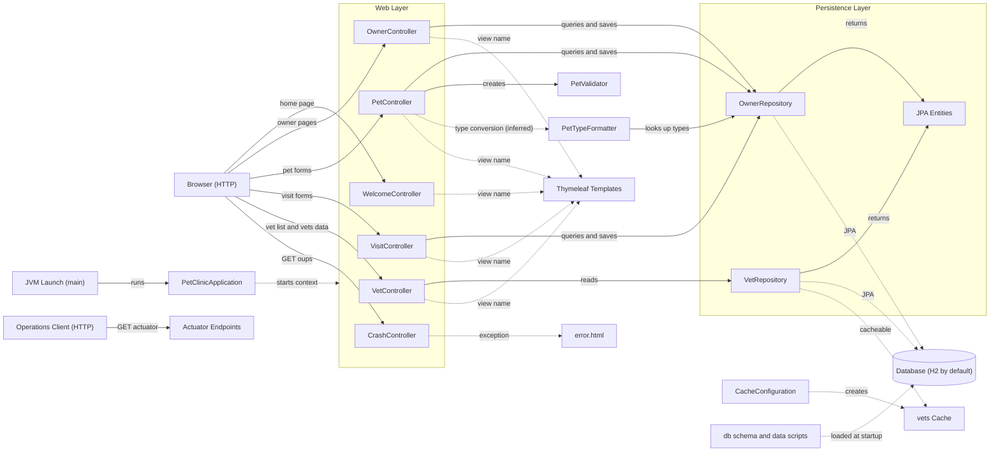
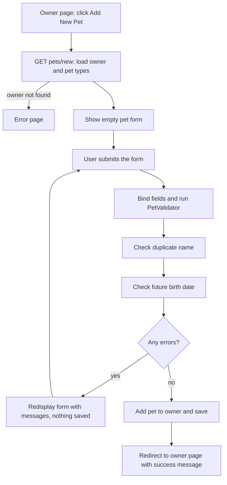

# Codebase Analysis

Findings are based on source and configuration files. The README was treated as a set of claims and checked against the code. Nothing was built, run, or modified. Line links point at the repository state at the time of writing.

## Table of Contents

1. [Purpose and Main Features](#purpose-and-main-features)
   - [Purpose](#purpose)
   - [Main Features](#main-features)
2. [Technology Stack](#technology-stack)
   - [Language and Runtime](#language-and-runtime)
   - [Application Framework](#application-framework)
   - [Persistence and Databases](#persistence-and-databases)
   - [Caching](#caching)
   - [Web and User Interface](#web-and-user-interface)
   - [Supporting Tools](#supporting-tools)
   - [Version Notes and Uncertainties](#version-notes-and-uncertainties)
3. [Startup Process](#startup-process)
   - [Entry Point](#entry-point)
   - [Configuration Loading](#configuration-loading)
   - [Important Initialization Steps](#important-initialization-steps)
   - [Startup Notes and Uncertainties](#startup-notes-and-uncertainties)
4. [Entry Points and Request Handling](#entry-points-and-request-handling)
   - [Request Flow](#request-flow)
   - [Endpoint Map](#endpoint-map)
   - [Cross-Cutting Request Behavior](#cross-cutting-request-behavior)
   - [Non-HTTP Entry Points](#non-http-entry-points)
5. [Architecture](#architecture)
   - [Architectural Style](#architectural-style)
   - [Components and Responsibilities](#components-and-responsibilities)
   - [Dependencies Between Components](#dependencies-between-components)
   - [Architecture Diagram](#architecture-diagram)
   - [Tracing One Request](#tracing-one-request)
   - [Architecture Notes and Uncertainties](#architecture-notes-and-uncertainties)
6. [Feature Trace](#feature-trace)
   - [Add New Pet Trace](#add-new-pet-trace)
   - [Add New Pet Flowchart](#add-new-pet-flowchart)
7. [Runbook](#runbook)
   - [Prerequisites and Services](#prerequisites-and-services)
   - [Environment Checks](#environment-checks)
   - [Build and Test](#build-and-test)
   - [Verifying Build and Test Results](#verifying-build-and-test-results)
   - [Starting the Application](#starting-the-application)
   - [Manual Feature Verification](#manual-feature-verification)
   - [Troubleshooting and Corrective Reruns](#troubleshooting-and-corrective-reruns)

---

## Purpose and Main Features

### Purpose

Spring Petclinic is a sample veterinary-clinic web application. Users look up pet owners, manage owners, their pets and pet visits, and browse the clinic's veterinarians. It is a server-rendered Spring MVC and Thymeleaf application backed by a relational database (in-memory H2 by default). It reads as a reference or demo project rather than a production system; no authentication or security configuration exists in the source (no Spring Security dependency in [pom.xml](../pom.xml#L40-L142)).

### Main Features

| Feature | Where It Lives |
| --- | --- |
| Welcome page | [WelcomeController.java](../src/main/java/org/springframework/samples/petclinic/system/WelcomeController.java#L25-L28) |
| Find owners by last name (prefix match, paginated, 5 per page) | [OwnerController.java](../src/main/java/org/springframework/samples/petclinic/owner/OwnerController.java#L85-L129), [OwnerRepository.java](../src/main/java/org/springframework/samples/petclinic/owner/OwnerRepository.java#L56-L58) |
| Create and edit owners | [OwnerController.java](../src/main/java/org/springframework/samples/petclinic/owner/OwnerController.java#L66-L83) and [L131-L150](../src/main/java/org/springframework/samples/petclinic/owner/OwnerController.java#L131-L150) |
| View an owner with pets and visits | [OwnerController.java](../src/main/java/org/springframework/samples/petclinic/owner/OwnerController.java#L157-L163) |
| Add and edit pets (duplicate-name and future-birth-date checks) | [PetController.java](../src/main/java/org/springframework/samples/petclinic/owner/PetController.java#L93-L160) |
| Record a pet visit | [VisitController.java](../src/main/java/org/springframework/samples/petclinic/owner/VisitController.java#L76-L94) |
| Browse veterinarians as an HTML page (paginated) and as a data endpoint | [VetController.java](../src/main/java/org/springframework/samples/petclinic/vet/VetController.java#L44-L76) |
| Deliberate error page to demonstrate exception handling | [CrashController.java](../src/main/java/org/springframework/samples/petclinic/system/CrashController.java#L31-L35) |
| Cached vet lookups | [VetRepository.java](../src/main/java/org/springframework/samples/petclinic/vet/VetRepository.java#L44-L56), [CacheConfiguration.java](../src/main/java/org/springframework/samples/petclinic/system/CacheConfiguration.java#L31-L38) |
| Operational endpoints (Actuator) | [application.properties](../src/main/resources/application.properties#L16-L17) |
| Message bundles in English, German, Spanish, Korean | [messages/](../src/main/resources/messages/) (see the localization note under [Cross-Cutting Request Behavior](#cross-cutting-request-behavior)) |

---

## Technology Stack

### Language and Runtime

| Technology | Version | Evidence |
| --- | --- | --- |
| Java | 17 | [pom.xml](../pom.xml#L20) `java.version`; Enforcer rule at [pom.xml](../pom.xml#L146-L165); [build.gradle](../build.gradle#L15) `sourceCompatibility = '17'`; CI matrix [maven-build.yml](../.github/workflows/maven-build.yml#L16-L17) |

### Application Framework

| Technology | Version | Evidence |
| --- | --- | --- |
| Spring Boot (parent BOM) | 3.2.1 (Maven) / 3.2.0 (Gradle) | [pom.xml](../pom.xml#L10-L14), [build.gradle](../build.gradle#L3) |
| Spring MVC (`spring-boot-starter-web`) | Managed by Boot BOM | [pom.xml](../pom.xml#L54-L57) |
| Bean Validation (`spring-boot-starter-validation`) | Managed by Boot BOM | [pom.xml](../pom.xml#L58-L61); used in [Owner.java](../src/main/java/org/springframework/samples/petclinic/owner/Owner.java#L49-L60) |
| Actuator (`spring-boot-starter-actuator`) | Managed by Boot BOM | [pom.xml](../pom.xml#L42-L45) |

### Persistence and Databases

| Technology | Version | Evidence |
| --- | --- | --- |
| Spring Data JPA / Hibernate | Managed by Boot BOM (exact versions not pinned in the repo) | [pom.xml](../pom.xml#L50-L53); entities such as [Owner.java](../src/main/java/org/springframework/samples/petclinic/owner/Owner.java#L45-L46) |
| H2 (default, in-memory) | Managed by Boot BOM | [pom.xml](../pom.xml#L73-L77); `database=h2` at [application.properties](../src/main/resources/application.properties#L2) |
| MySQL driver (profile `mysql`) | Managed by Boot BOM | [pom.xml](../pom.xml#L78-L82); [application-mysql.properties](../src/main/resources/application-mysql.properties) |
| PostgreSQL driver (profile `postgres`) | Managed by Boot BOM | [pom.xml](../pom.xml#L83-L87); [application-postgres.properties](../src/main/resources/application-postgres.properties) |
| MySQL and PostgreSQL server images (local dev containers) | 8.2 and 16.1 | [docker-compose.yml](../docker-compose.yml#L5), [docker-compose.yml](../docker-compose.yml#L19) |

Schema and seed data exist per database under [db/](../src/main/resources/db/) (`h2`, `hsqldb`, `mysql`, `postgres`). I found no configuration that selects the `hsqldb` scripts.

### Caching

| Technology | Version | Evidence |
| --- | --- | --- |
| Spring Cache abstraction | Managed by Boot BOM | [pom.xml](../pom.xml#L46-L49); `@EnableCaching` at [CacheConfiguration.java](../src/main/java/org/springframework/samples/petclinic/system/CacheConfiguration.java#L32) |
| JCache API (`javax.cache:cache-api`) | Managed by Boot BOM | [pom.xml](../pom.xml#L90-L93) |
| Caffeine | Managed by Boot BOM | [pom.xml](../pom.xml#L94-L97) |

### Web and User Interface

| Technology | Version | Evidence |
| --- | --- | --- |
| Thymeleaf (`spring-boot-starter-thymeleaf`) | Managed by Boot BOM | [pom.xml](../pom.xml#L62-L65); templates in [templates/](../src/main/resources/templates/) |
| Bootstrap (WebJar) | 5.3.2 | [pom.xml](../pom.xml#L27); referenced at [layout.html](../src/main/resources/templates/fragments/layout.html#L90) |
| Font Awesome (WebJar) | 4.7.0 | [pom.xml](../pom.xml#L28); referenced at [layout.html](../src/main/resources/templates/fragments/layout.html#L20) |
| SCSS sources compiled to `petclinic.css` | libsass-maven-plugin 0.2.29 (Maven profile `css` only) | [pom.xml](../pom.xml#L32), [pom.xml](../pom.xml#L316-L368), [scss/](../src/main/scss/) |
| JAXB API (annotations on `Vets` and `Vet`) | Managed by Boot BOM | [pom.xml](../pom.xml#L137-L140) |

### Supporting Tools

| Tool | Version | Role | Evidence |
| --- | --- | --- | --- |
| Maven (via wrapper) | Set in wrapper properties (not read) | Primary build | [maven-wrapper.properties](../.mvn/wrapper/maven-wrapper.properties) |
| Gradle (via wrapper) | Set in wrapper properties (not read) | Alternative build | [build.gradle](../build.gradle), [gradle-wrapper.properties](../gradle/wrapper/gradle-wrapper.properties) |
| Spring Java Format | 0.0.40 | Code-format validation at the `validate` phase | [pom.xml](../pom.xml#L36), [pom.xml](../pom.xml#L166-L178) |
| Checkstyle with nohttp | 10.12.5 and 0.0.11 (plugin 3.3.1) | Rejects plain (non-HTTPS) URLs; scans every file in the repository, including `docs/` | [pom.xml](../pom.xml#L179-L211), [src/checkstyle/](../src/checkstyle/) |
| JaCoCo | 0.8.15 | Coverage agent and report | [pom.xml](../pom.xml#L237-L255) |
| git-commit-id plugin | Boot-managed | Writes `git.properties` for Actuator | [pom.xml](../pom.xml#L259-L266) |
| GraalVM native-maven-plugin | Boot-managed | Native-image support; hints in [PetClinicRuntimeHints.java](../src/main/java/org/springframework/samples/petclinic/PetClinicRuntimeHints.java#L28-L36) | [pom.xml](../pom.xml#L212-L215) |
| `spring-boot-starter-test` (JUnit, Spring Test) | Boot-managed | Unit and integration tests | [pom.xml](../pom.xml#L66-L70) |
| Testcontainers, Spring Boot Docker Compose support | Boot-managed | Database integration tests and dev runs | [pom.xml](../pom.xml#L116-L135), [MySqlIntegrationTests.java](../src/test/java/org/springframework/samples/petclinic/MySqlIntegrationTests.java#L40-L47) |
| Spring Boot DevTools | Boot-managed | Test scope in Maven, `developmentOnly` in Gradle | [pom.xml](../pom.xml#L111-L115), [build.gradle](../build.gradle#L40) |
| JMeter test plan | Not versioned | Load-test definition | [petclinic_test_plan.jmx](../src/test/jmeter/petclinic_test_plan.jmx) |
| GitHub Actions | `checkout@v4`, `setup-java@v4` | CI runs `./mvnw -B package` on JDK 17 | [maven-build.yml](../.github/workflows/maven-build.yml) |
| Dev Container and Gitpod | Java 17.0.7-ms (dev container) | Hosted dev environments | [Dockerfile](../.devcontainer/Dockerfile#L11), [.gitpod.yml](../.gitpod.yml) |

### Version Notes and Uncertainties

- **Maven and Gradle disagree on the Boot version.** Maven uses 3.2.1; Gradle uses 3.2.0 ([pom.xml](../pom.xml#L13), [build.gradle](../build.gradle#L3)). Maven appears to be the primary build because CI uses it, but that is an inference.
- **Transitive versions are not recorded.** Hibernate, Thymeleaf, Tomcat, H2, Jackson, Caffeine and the JDBC drivers come from the Spring Boot BOM. I did not resolve the dependency tree, so I give no numbers for them.
- **Checkstyle is still configured.** A recent commit message says "Remove checkstyle and leave behind spring javaformat", yet [pom.xml](../pom.xml#L179-L211) still declares `maven-checkstyle-plugin` with nohttp rules. I did not investigate why.
- **JCache provider is unclear.** Only `javax.cache:cache-api` and core `caffeine` are declared; no separate JCache implementation is in the pom. Whether Boot ends up with a JCache-backed manager (which the `JCacheManagerCustomizer` in [CacheConfiguration.java](../src/main/java/org/springframework/samples/petclinic/system/CacheConfiguration.java#L36-L38) targets) or a Caffeine manager could not be determined from source alone.
- **Java 17 is a minimum.** The Enforcer rule requires "at least" 17, and the README says "Java 17 or newer" ([readme.md](../readme.md#L11)).

---

## Startup Process

### Entry Point

The `main` method is in [PetClinicApplication.java](../src/main/java/org/springframework/samples/petclinic/PetClinicApplication.java#L37-L39) and calls `SpringApplication.run(PetClinicApplication.class, args)`. The class carries [`@SpringBootApplication`](../src/main/java/org/springframework/samples/petclinic/PetClinicApplication.java#L33), which enables component scanning from the `org.springframework.samples.petclinic` package, auto-configuration, and configuration-class processing. It also has [`@ImportRuntimeHints(PetClinicRuntimeHints.class)`](../src/main/java/org/springframework/samples/petclinic/PetClinicApplication.java#L34), used for GraalVM native images.

The application is packaged as a Spring Boot executable jar (`spring-boot-maven-plugin` at [pom.xml](../pom.xml#L216-L236)). I found no `Dockerfile` for the application itself, which agrees with the README.

### Configuration Loading

1. **Base settings** come from [application.properties](../src/main/resources/application.properties):
   - `database=h2`, interpolated into the SQL script locations `classpath*:db/${database}/schema.sql` and `data.sql` ([L2-L4](../src/main/resources/application.properties#L2-L4)).
   - `spring.jpa.hibernate.ddl-auto=none` ([L10](../src/main/resources/application.properties#L10)), so Hibernate does not create the schema; the SQL scripts do.
   - `spring.jpa.open-in-view=true` ([L11](../src/main/resources/application.properties#L11)).
   - `spring.messages.basename=messages/messages` ([L14](../src/main/resources/application.properties#L14)).
   - All Actuator web endpoints exposed ([L17](../src/main/resources/application.properties#L17)).
   - Static resource `max-age=12h` ([L25](../src/main/resources/application.properties#L25)).
2. **Profiles** `mysql` and `postgres` override the datasource through [application-mysql.properties](../src/main/resources/application-mysql.properties) and [application-postgres.properties](../src/main/resources/application-postgres.properties). Each sets `database=...`, a datasource URL, username and password read from environment variables with defaults (for example `MYSQL_URL`, `POSTGRES_URL`), and `spring.sql.init.mode=always`. A profile must be chosen explicitly (for example `spring.profiles.active=mysql`, per [readme.md](../readme.md#L50)); otherwise H2 is used.
3. **Default H2 datasource:** no `spring.datasource.*` is set in the default configuration, so Boot's embedded-database auto-configuration presumably supplies an in-memory H2 database. This is inferred from Boot behavior and the H2 runtime dependency, not stated in this repository's config.

### Important Initialization Steps

1. `SpringApplication.run` creates the application context and starts the embedded servlet container (Tomcat, via `spring-boot-starter-web`; the container choice is Boot's default, not shown in this repo). I found no `server.port` override, so the default 8080 should apply, which matches the README ([readme.md](../readme.md#L20)).
2. Spring scans and registers controllers (`@Controller`), the `PetTypeFormatter` (`@Component`, [PetTypeFormatter.java](../src/main/java/org/springframework/samples/petclinic/owner/PetTypeFormatter.java#L36)), the Spring Data repositories ([OwnerRepository](../src/main/java/org/springframework/samples/petclinic/owner/OwnerRepository.java#L38), [VetRepository](../src/main/java/org/springframework/samples/petclinic/vet/VetRepository.java#L38)), and the JPA entities.
3. [CacheConfiguration](../src/main/java/org/springframework/samples/petclinic/system/CacheConfiguration.java#L31-L38) enables caching and registers a customizer that creates a cache named `vets` with statistics enabled.
4. Database initialization runs the schema and data scripts from `db/<database>/`. For H2 these are [schema.sql](../src/main/resources/db/h2/schema.sql) (drops and recreates the tables) and [data.sql](../src/main/resources/db/h2/data.sql). For MySQL and PostgreSQL the profile sets `spring.sql.init.mode=always`, with a comment that the SQL is idempotent ([application-mysql.properties](../src/main/resources/application-mysql.properties#L6-L7)). For H2 the Boot default for embedded databases applies (inferred).
5. Thymeleaf is set to `HTML` mode ([application.properties](../src/main/resources/application.properties#L7)); templates load from `src/main/resources/templates/`.
6. Actuator build and git information appear only if the build produced `build-info.properties` and `git.properties` ([pom.xml](../pom.xml#L216-L266)).

### Startup Notes and Uncertainties

- **The H2 console claim is not supported by configuration.** The README says the H2 console is exposed at `/h2-console` ([readme.md](../readme.md#L47)). No `spring.h2.console.*` property exists in [src/main/resources](../src/main/resources/), and DevTools is `test` scoped in Maven. I could not confirm the console is reachable in a normal Maven run; it may work only with DevTools on the classpath (for example through the test-source `main()` methods, or Gradle's `developmentOnly`). I did not run it to check.
- **Unused imports in the entry class.** [PetClinicApplication.java](../src/main/java/org/springframework/samples/petclinic/PetClinicApplication.java#L20-L25) imports `Bean`, `SessionLocaleResolver` and `Locale`, but I saw no code using them, and no locale resolver bean is defined there.
- **Alternate launchers live in test sources:** `main()` methods in [PetClinicIntegrationTests.java](../src/test/java/org/springframework/samples/petclinic/PetClinicIntegrationTests.java#L59), [MysqlTestApplication.java](../src/test/java/org/springframework/samples/petclinic/MysqlTestApplication.java#L42) and [PostgresIntegrationTests.java](../src/test/java/org/springframework/samples/petclinic/PostgresIntegrationTests.java#L70). They match the README's development description ([readme.md](../readme.md#L81)), except that the README spells the MySQL class `MySqlTestApplication` while the file is `MysqlTestApplication`.
- [docker-java.properties](../src/test/resources/docker-java.properties) sets `api.version=1.44` for the Docker client; its purpose is inferred from the file name and the latest commit message.

---

## Entry Points and Request Handling

### Request Flow

I found no custom servlet, filter, or `WebMvcConfigurer` in `src/main`; HTTP handling relies on Spring Boot's auto-configured Spring MVC. A typical request:

1. The embedded servlet container receives the request and hands it to Spring's `DispatcherServlet` (standard Boot behavior).
2. The dispatcher maps the path to an `@Controller` method annotated with `@GetMapping` or `@PostMapping`.
3. Before the handler runs, `@ModelAttribute` and `@InitBinder` methods prepare data. For example, [OwnerController.findOwner](../src/main/java/org/springframework/samples/petclinic/owner/OwnerController.java#L61-L64) loads the owner for `{ownerId}`, and [`setDisallowedFields("id")`](../src/main/java/org/springframework/samples/petclinic/owner/OwnerController.java#L56-L59) stops the `id` field being bound from form input.
4. Form posts are bound and validated: Bean Validation on `Owner` and `Visit`, or the custom [PetValidator](../src/main/java/org/springframework/samples/petclinic/owner/PetValidator.java#L32-L54) for `Pet`. Errors re-render the form; success saves through the repository and redirects with a flash message.
5. Controllers return a view name; Thymeleaf renders it inside the shared [layout.html](../src/main/resources/templates/fragments/layout.html) fragment.
6. Repositories are Spring Data `Repository` interfaces with `@Query` methods. Read methods are marked `@Transactional(readOnly = true)`.

### Endpoint Map

| Method and Path | Handler | Result |
| --- | --- | --- |
| `GET /` | [WelcomeController.welcome](../src/main/java/org/springframework/samples/petclinic/system/WelcomeController.java#L25-L28) | View `welcome` |
| `GET /owners/find` | [initFindForm](../src/main/java/org/springframework/samples/petclinic/owner/OwnerController.java#L85-L88) | Search form |
| `GET /owners?lastName=&page=` | [processFindForm](../src/main/java/org/springframework/samples/petclinic/owner/OwnerController.java#L90-L114) | No match: form with error. One match: redirect to the owner. Several: paginated list |
| `GET /owners/new`, `POST /owners/new` | [OwnerController](../src/main/java/org/springframework/samples/petclinic/owner/OwnerController.java#L66-L83) | Create owner |
| `GET /owners/{ownerId}` | [showOwner](../src/main/java/org/springframework/samples/petclinic/owner/OwnerController.java#L157-L163) | Owner details view |
| `GET` and `POST /owners/{ownerId}/edit` | [OwnerController](../src/main/java/org/springframework/samples/petclinic/owner/OwnerController.java#L131-L150) | Update owner |
| `GET` and `POST /owners/{ownerId}/pets/new` | [PetController](../src/main/java/org/springframework/samples/petclinic/owner/PetController.java#L93-L122) | Add pet |
| `GET` and `POST /owners/{ownerId}/pets/{petId}/edit` | [PetController](../src/main/java/org/springframework/samples/petclinic/owner/PetController.java#L124-L160) | Edit pet |
| `GET` and `POST /owners/{ownerId}/pets/{petId}/visits/new` | [VisitController](../src/main/java/org/springframework/samples/petclinic/owner/VisitController.java#L76-L94) | Book visit |
| `GET /vets.html?page=` | [showVetList](../src/main/java/org/springframework/samples/petclinic/vet/VetController.java#L44-L52) | Paginated HTML list (5 per page) |
| `GET /vets` | [showResourcesVetList](../src/main/java/org/springframework/samples/petclinic/vet/VetController.java#L69-L76) | `@ResponseBody` of `Vets`; format depends on content negotiation |
| `GET /oups` | [CrashController](../src/main/java/org/springframework/samples/petclinic/system/CrashController.java#L31-L35) | Throws `RuntimeException` on purpose |
| `GET /actuator/**` | Spring Boot Actuator | All web endpoints exposed ([application.properties](../src/main/resources/application.properties#L17)) |
| `GET /resources/**`, `/webjars/**` | Boot static-resource handling | CSS, images, Bootstrap and Font Awesome from WebJars (paths seen in [layout.html](../src/main/resources/templates/fragments/layout.html#L20-L21)) |

Details worth knowing:

- Pet and visit controllers both live under `/owners/{ownerId}`: `PetController` declares it once at class level ([PetController.java](../src/main/java/org/springframework/samples/petclinic/owner/PetController.java#L41-L43)); `VisitController` spells the full path on each method.
- `PetTypeFormatter` converts the pet type name submitted by a form into a `PetType` by loading all types and matching by name ([PetTypeFormatter.java](../src/main/java/org/springframework/samples/petclinic/owner/PetTypeFormatter.java#L51-L60)).
- Owner search uses a JPQL `LIKE :lastName%` prefix match ([OwnerRepository.java](../src/main/java/org/springframework/samples/petclinic/owner/OwnerRepository.java#L56)). The H2 schema declares `last_name` as `VARCHAR_IGNORECASE` ([schema.sql](../src/main/resources/db/h2/schema.sql#L39)), which would make search case-insensitive on H2. I did not check how the MySQL and PostgreSQL scripts handle case.
- `/vets` serialization: [`Vets`](../src/main/java/org/springframework/samples/petclinic/vet/Vets.java#L30-L35) carries JAXB annotations, but the pom has no Jackson XML module, so JSON is the likely output. I did not verify the actual response format.
- `showVetList` builds a `Vets` object it never uses ([VetController.java](../src/main/java/org/springframework/samples/petclinic/vet/VetController.java#L48-L50)); the view reads the `listVets` model attribute instead.

### Cross-Cutting Request Behavior

- **Error handling:** there is no `@ControllerAdvice` or `@ExceptionHandler` in `src/main`. Unhandled exceptions fall through to Boot's default error handling, which should render [error.html](../src/main/resources/templates/error.html) (it shows the `message` attribute). The `/oups` endpoint and [CrashControllerIntegrationTests](../src/test/java/org/springframework/samples/petclinic/system/CrashControllerIntegrationTests.java#L67-L84) exercise this path. `PetController` also throws `IllegalArgumentException` when an owner is missing ([L62-L64](../src/main/java/org/springframework/samples/petclinic/owner/PetController.java#L62-L64)), which would reach the same handling.
- **Caching:** both `VetRepository.findAll` methods are `@Cacheable("vets")` ([VetRepository.java](../src/main/java/org/springframework/samples/petclinic/vet/VetRepository.java#L44-L56)). They share one cache name; Spring's default key generation should tell them apart by argument (inferred). No eviction is configured, which is consistent with vets being read-only in this app.
- **Persistence session scope:** `spring.jpa.open-in-view=true` keeps the JPA session open through view rendering ([application.properties](../src/main/resources/application.properties#L11)).
- **Eager loading:** `Owner.pets` and `Vet.specialties` are `FetchType.EAGER` ([Owner.java](../src/main/java/org/springframework/samples/petclinic/owner/Owner.java#L62), [Vet.java](../src/main/java/org/springframework/samples/petclinic/vet/Vet.java#L48)).
- **Input binding:** `id` is disallowed for binding in the owner and visit controllers and in the pet controller's `owner` binder ([PetController.java](../src/main/java/org/springframework/samples/petclinic/owner/PetController.java#L83-L86)). The `pet` binder in the same controller installs `PetValidator` and does not disallow `id` ([L88-L91](../src/main/java/org/springframework/samples/petclinic/owner/PetController.java#L88-L91)).
- **Localization:** message bundles for four languages exist ([messages/](../src/main/resources/messages/)), but I found no `LocaleResolver`, `LocaleChangeInterceptor`, or language switcher in the Java sources or the layout template, so the locale presumably follows the browser's `Accept-Language` header through Boot's default resolver. This is an inference, not verified. The base bundle holds only a few validation-style messages ([messages.properties](../src/main/resources/messages/messages.properties)).
- **Security:** no authentication, authorization, or CSRF configuration is present. Because all Actuator endpoints are exposed ([application.properties](../src/main/resources/application.properties#L17)) with no security layer, that setting deserves review before any non-demo use.
- **Flash messages:** successful create, update, and booking actions set a `message` flash attribute, and failures set `error` (for example [OwnerController.java](../src/main/java/org/springframework/samples/petclinic/owner/OwnerController.java#L76-L81)). The strings are hard-coded rather than taken from the message bundles, and one contains typos ([VisitController.java](../src/main/java/org/springframework/samples/petclinic/owner/VisitController.java#L92)).

### Non-HTTP Entry Points

I found no message listeners, scheduled jobs, `CommandLineRunner` or `ApplicationRunner` beans, or other non-HTTP entry points in `src/main`. The only non-request initialization is the database script execution and cache creation described under [Startup Process](#startup-process).

---

## Architecture

### Architectural Style

The application is a single deployable Spring Boot service with a classic layered, package-by-feature layout: controllers (web layer), Spring Data repositories (persistence layer), and JPA entities (domain model), with Thymeleaf templates as the view layer. There is no separate service layer; controllers call repositories directly (for example [OwnerController](../src/main/java/org/springframework/samples/petclinic/owner/OwnerController.java#L50-L54)). Feature packages are `owner`, `vet`, `system` and `model` under [petclinic](../src/main/java/org/springframework/samples/petclinic/).

### Components and Responsibilities

| Component | Responsibility | Source |
| --- | --- | --- |
| Application bootstrap | Starts Spring Boot and registers native-image hints | [PetClinicApplication.java](../src/main/java/org/springframework/samples/petclinic/PetClinicApplication.java#L33-L39), [PetClinicRuntimeHints.java](../src/main/java/org/springframework/samples/petclinic/PetClinicRuntimeHints.java#L25-L36) |
| `OwnerController` | Owner search, create, edit and detail pages | [OwnerController.java](../src/main/java/org/springframework/samples/petclinic/owner/OwnerController.java#L45-L165) |
| `PetController` | Add and edit pets under an owner; supplies pet types to forms | [PetController.java](../src/main/java/org/springframework/samples/petclinic/owner/PetController.java#L41-L162) |
| `VisitController` | Book a visit for a pet | [VisitController.java](../src/main/java/org/springframework/samples/petclinic/owner/VisitController.java#L39-L96) |
| `VetController` | Vet list as HTML and as a response body | [VetController.java](../src/main/java/org/springframework/samples/petclinic/vet/VetController.java#L35-L78) |
| `WelcomeController`, `CrashController` | Home page; deliberate exception | [WelcomeController.java](../src/main/java/org/springframework/samples/petclinic/system/WelcomeController.java#L22-L28), [CrashController.java](../src/main/java/org/springframework/samples/petclinic/system/CrashController.java#L28-L35) |
| `PetValidator` | Custom validation of `Pet` (name, type, birth date) | [PetValidator.java](../src/main/java/org/springframework/samples/petclinic/owner/PetValidator.java#L32-L62) |
| `PetTypeFormatter` | Converts a pet type name to a `PetType` using the repository | [PetTypeFormatter.java](../src/main/java/org/springframework/samples/petclinic/owner/PetTypeFormatter.java#L36-L60) |
| `OwnerRepository` | Owner queries and save; pet type lookup | [OwnerRepository.java](../src/main/java/org/springframework/samples/petclinic/owner/OwnerRepository.java#L38-L82) |
| `VetRepository` | Cached read-only vet queries | [VetRepository.java](../src/main/java/org/springframework/samples/petclinic/vet/VetRepository.java#L38-L58) |
| `CacheConfiguration` | Enables caching and creates the `vets` cache | [CacheConfiguration.java](../src/main/java/org/springframework/samples/petclinic/system/CacheConfiguration.java#L31-L38) |
| Domain entities | `Owner`, `Pet`, `Visit`, `PetType`, `Vet`, `Specialty`, plus base classes `BaseEntity`, `NamedEntity`, `Person` | [owner/](../src/main/java/org/springframework/samples/petclinic/owner/), [vet/](../src/main/java/org/springframework/samples/petclinic/vet/), [model/](../src/main/java/org/springframework/samples/petclinic/model/) |
| `Vets` | Wrapper object returned by the `/vets` endpoint | [Vets.java](../src/main/java/org/springframework/samples/petclinic/vet/Vets.java#L30-L35) |
| Templates | Thymeleaf pages sharing one layout fragment | [templates/](../src/main/resources/templates/), [layout.html](../src/main/resources/templates/fragments/layout.html#L2) |
| Database scripts | Schema and seed data per database | [db/](../src/main/resources/db/), [application.properties](../src/main/resources/application.properties#L2-L4) |
| Configuration | Properties and profile overrides | [application.properties](../src/main/resources/application.properties), [application-mysql.properties](../src/main/resources/application-mysql.properties), [application-postgres.properties](../src/main/resources/application-postgres.properties) |

### Dependencies Between Components

**Direct dependencies** (visible in the Java source):

- `OwnerController`, `PetController` and `VisitController` each receive an `OwnerRepository` through their constructors ([OwnerController.java](../src/main/java/org/springframework/samples/petclinic/owner/OwnerController.java#L52-L54), [PetController.java](../src/main/java/org/springframework/samples/petclinic/owner/PetController.java#L49-L51), [VisitController.java](../src/main/java/org/springframework/samples/petclinic/owner/VisitController.java#L44-L46)).
- `VetController` receives a `VetRepository` ([VetController.java](../src/main/java/org/springframework/samples/petclinic/vet/VetController.java#L40-L42)).
- `PetController` creates a `PetValidator` itself ([PetController.java](../src/main/java/org/springframework/samples/petclinic/owner/PetController.java#L88-L91)).
- `PetTypeFormatter` receives an `OwnerRepository` ([PetTypeFormatter.java](../src/main/java/org/springframework/samples/petclinic/owner/PetTypeFormatter.java#L41-L44)).
- Entity relationships: `Owner` has many `Pet` ([Owner.java](../src/main/java/org/springframework/samples/petclinic/owner/Owner.java#L62-L65)); `Pet` has one `PetType` and many `Visit` ([Pet.java](../src/main/java/org/springframework/samples/petclinic/owner/Pet.java#L51-L58)); `Vet` has many `Specialty` ([Vet.java](../src/main/java/org/springframework/samples/petclinic/vet/Vet.java#L48-L50)).
- `PetClinicRuntimeHints` references `BaseEntity`, `Person` and `Vet` ([PetClinicRuntimeHints.java](../src/main/java/org/springframework/samples/petclinic/PetClinicRuntimeHints.java#L33-L35)).
- The controllers and repositories I read in `owner` and `vet` do not reference each other.

**Framework-managed interactions** (configured by annotations or properties, with the work done by Spring or Hibernate):

- URL routing to controller methods, and data binding, validation and redirects ([Request Flow](#request-flow)).
- Controllers return view names that Thymeleaf resolves to templates (for example [WelcomeController.java](../src/main/java/org/springframework/samples/petclinic/system/WelcomeController.java#L25-L28) returns `welcome`).
- Repository interfaces have no implementation class in the source; Spring Data supplies it, and queries run through JPA against the configured database ([OwnerRepository.java](../src/main/java/org/springframework/samples/petclinic/owner/OwnerRepository.java#L56-L66)).
- `@Cacheable("vets")` on `VetRepository` methods is applied by Spring's caching support, with the cache created in `CacheConfiguration`.
- Schema and seed scripts run at startup through Boot's SQL initialization ([application.properties](../src/main/resources/application.properties#L3-L4)).
- `PetTypeFormatter` is a `@Component`; Boot is expected to register it as an MVC formatter. This is standard Boot behavior and not shown in this repository (inferred).

### Architecture Diagram

Solid arrows are direct dependencies in the code. Dashed arrows are framework-managed interactions. Framework internals such as the dispatcher and the transaction manager are omitted.



### Tracing One Request

Representative request: submitting the Add Pet form, `POST /owners/{ownerId}/pets/new`.

1. The browser posts the form. Spring MVC routes it to [`PetController.processCreationForm`](../src/main/java/org/springframework/samples/petclinic/owner/PetController.java#L101-L122), because the class-level mapping is `/owners/{ownerId}` ([L42](../src/main/java/org/springframework/samples/petclinic/owner/PetController.java#L42)).
2. Before the handler, the `@ModelAttribute` methods run: [`populatePetTypes`](../src/main/java/org/springframework/samples/petclinic/owner/PetController.java#L53-L56) and [`findOwner`](../src/main/java/org/springframework/samples/petclinic/owner/PetController.java#L58-L66) both call `OwnerRepository` (the latter via [`findById`](../src/main/java/org/springframework/samples/petclinic/owner/OwnerRepository.java#L65-L67), which fetches the owner's pets), and [`findPet`](../src/main/java/org/springframework/samples/petclinic/owner/PetController.java#L68-L74) returns a new `Pet`.
3. Form fields are bound onto the `Pet`; the type name is converted to a `PetType` by `PetTypeFormatter` (inferred wiring), and [`PetValidator`](../src/main/java/org/springframework/samples/petclinic/owner/PetValidator.java#L36-L54) checks name, type and birth date.
4. The handler rejects a duplicate name or a future birth date ([L104-L111](../src/main/java/org/springframework/samples/petclinic/owner/PetController.java#L104-L111)), adds the pet to the owner ([`Owner.addPet`](../src/main/java/org/springframework/samples/petclinic/owner/Owner.java#L95-L99)), and returns the form view again if there are errors.
5. On success, `owners.save(owner)` persists the owner. Because `Owner.pets` cascades `ALL` ([Owner.java](../src/main/java/org/springframework/samples/petclinic/owner/Owner.java#L62)), the new pet is saved with it. The handler then sets a flash message and redirects to `/owners/{ownerId}`.
6. The browser follows the redirect to [`OwnerController.showOwner`](../src/main/java/org/springframework/samples/petclinic/owner/OwnerController.java#L157-L163), which reloads the owner and renders the `owners/ownerDetails` template.

### Architecture Notes and Uncertainties

- **Transaction boundaries are not explicit for writes.** `save` on `OwnerRepository` has no `@Transactional` annotation ([OwnerRepository.java](../src/main/java/org/springframework/samples/petclinic/owner/OwnerRepository.java#L73)), and no service layer exists. The transaction presumably comes from Spring Data's repository defaults, but I did not confirm that for this declaration style.
- **Business logic sits in controllers and entities.** Duplicate-name and date checks live in `PetController`, and lookup helpers such as `getPet` live in `Owner`. This is a design observation, not a defect.
- **One repository serves two entities.** `OwnerRepository` also serves `PetType` queries ([L44-L46](../src/main/java/org/springframework/samples/petclinic/owner/OwnerRepository.java#L44-L46)); I found no `Pet` or `PetType` repository.
- **Cache provider uncertainty** from [Version Notes and Uncertainties](#version-notes-and-uncertainties) applies to the `vets Cache` node in the diagram.
- **Diagram scope.** Templates are shown only at the level of "view name"; I did not map each controller method to its template. The `/vets` endpoint and the HTML vet page share `VetController` and `VetRepository`. I did not render the Mermaid diagram, so check that it displays correctly in your viewer.

---

## Feature Trace

### Add New Pet Trace

The trace covers one path from the owner page to the saved pet, with the alternatives the code supports. Tests for this feature are listed under [Verifying Build and Test Results](#verifying-build-and-test-results).

| # | Step | What Happens | Classes and Functions | Source |
| --- | --- | --- | --- | --- |
| 1 | Start from the owner page | The user opens an owner and clicks **Add New Pet**, a link to `/owners/{ownerId}/pets/new`. | `OwnerController.showOwner`, `ownerDetails.html` | [showOwner](../src/main/java/org/springframework/samples/petclinic/owner/OwnerController.java#L157-L163), [link](../src/main/resources/templates/owners/ownerDetails.html#L43-L44) |
| 2 | Prepare the form request | Before the GET handler, three `@ModelAttribute` methods run: pet types (sorted by name), the owner (with pets), and a new empty `Pet` because no `petId` is present. **Alternative:** if the owner does not exist, `findOwner` throws `IllegalArgumentException` and the request ends in the error handling described in [Cross-Cutting Request Behavior](#cross-cutting-request-behavior). | `PetController.populatePetTypes`, `findOwner`, `findPet`; `OwnerRepository.findPetTypes`, `findById` | [PetController L53-L74](../src/main/java/org/springframework/samples/petclinic/owner/PetController.java#L53-L74), [OwnerRepository L44-L67](../src/main/java/org/springframework/samples/petclinic/owner/OwnerRepository.java#L44-L67) |
| 3 | Show the empty form | A new `Pet` is attached to the owner in memory (not saved) and the view `pets/createOrUpdatePetForm` is returned. The form posts back to the same URL. The type dropdown has no blank option, so a browser always submits a type. | `PetController.initCreationForm`, `Owner.addPet` | [initCreationForm](../src/main/java/org/springframework/samples/petclinic/owner/PetController.java#L93-L99), [Owner.addPet](../src/main/java/org/springframework/samples/petclinic/owner/Owner.java#L95-L99), [form](../src/main/resources/templates/pets/createOrUpdatePetForm.html#L10-L24), [select](../src/main/resources/templates/fragments/selectField.html#L9-L13) |
| 4 | Submit the form | The browser sends `POST /owners/{ownerId}/pets/new` with `name`, `birthDate`, `type` and a hidden empty `id`. The `@ModelAttribute` methods from step 2 run again. | `PetController.processCreationForm` | [L101-L122](../src/main/java/org/springframework/samples/petclinic/owner/PetController.java#L101-L122) |
| 5 | Bind fields | The `pet` binder installs `PetValidator`. The date string is parsed using `yyyy-MM-dd`, and the type name is converted to a `PetType` by looking up all types. **Alternative:** an unparseable date or unknown type name becomes a binding error (the date uses message `typeMismatch.birthDate`; the type's error text was not checked). | `PetController.initPetBinder`, `Pet.birthDate`, `PetTypeFormatter.parse` | [initPetBinder](../src/main/java/org/springframework/samples/petclinic/owner/PetController.java#L88-L91), [Pet L47-L53](../src/main/java/org/springframework/samples/petclinic/owner/Pet.java#L47-L53), [parse](../src/main/java/org/springframework/samples/petclinic/owner/PetTypeFormatter.java#L51-L60) |
| 6 | **Decision:** required fields | `PetValidator` rejects a blank name, a missing type (new pets only), and a missing birth date with code `required`. | `PetValidator.validate` | [L36-L54](../src/main/java/org/springframework/samples/petclinic/owner/PetValidator.java#L36-L54) |
| 7 | **Decision:** duplicate name | If the name has text, the pet is new, and the owner already has a saved pet with that name (case-insensitive), the handler rejects `name` with code `duplicate`. | `Owner.getPet(name, true)` | [PetController L104-L106](../src/main/java/org/springframework/samples/petclinic/owner/PetController.java#L104-L106), [Owner L132-L143](../src/main/java/org/springframework/samples/petclinic/owner/Owner.java#L132-L143) |
| 8 | **Decision:** future birth date | A birth date after today is rejected with `typeMismatch.birthDate`. | `PetController.processCreationForm` | [L108-L111](../src/main/java/org/springframework/samples/petclinic/owner/PetController.java#L108-L111) |
| 9 | **Decision:** any errors? | The pet is added to the owner's list in memory, then errors are checked. **Alternative outcome:** with errors, the form is shown again (HTTP 200) with field messages and nothing is saved. | `owner.addPet`, `result.hasErrors()`, `inputField` fragment | [L113-L117](../src/main/java/org/springframework/samples/petclinic/owner/PetController.java#L113-L117), [inputField](../src/main/resources/templates/fragments/inputField.html#L18-L22) |
| 10 | Save | `owners.save(owner)` persists the owner. `Owner.pets` cascades all operations, so the new pet is inserted into `pets` with the owner's id, and its id is generated by the database. | `OwnerRepository.save`, `Owner.pets`, `BaseEntity.id` | [L119](../src/main/java/org/springframework/samples/petclinic/owner/PetController.java#L119), [save](../src/main/java/org/springframework/samples/petclinic/owner/OwnerRepository.java#L73), [Owner L62-L65](../src/main/java/org/springframework/samples/petclinic/owner/Owner.java#L62-L65), [BaseEntity L35-L37](../src/main/java/org/springframework/samples/petclinic/model/BaseEntity.java#L35-L37) |
| 11 | Redirect | A flash message "New Pet has been Added" is set and the response redirects to `/owners/{ownerId}`. | `RedirectAttributes` | [L120-L121](../src/main/java/org/springframework/samples/petclinic/owner/PetController.java#L120-L121) |
| 12 | Final outcome | The owner page reloads, shows the success banner, and lists the new pet. A script hides the banner after a few seconds. | `OwnerController.showOwner`, `ownerDetails.html` | [showOwner](../src/main/java/org/springframework/samples/petclinic/owner/OwnerController.java#L157-L163), [banner](../src/main/resources/templates/owners/ownerDetails.html#L11-L13), [pet list](../src/main/resources/templates/owners/ownerDetails.html#L53-L62) |

Observations (not verified by running):

- A database failure during save is not handled in this controller, so it would presumably reach the default error handling.
- Because the pet is added to the owner before the error check (step 9), an invalid pet is attached to the in-memory owner for that request only; I found no code that saves it in that case.
- The `type` field cannot be blank from the browser form, so the "missing type" rule is reachable only through a crafted request or a test.

### Add New Pet Flowchart



---

## Runbook

All commands run from the repository root. Execution results below are **PENDING** until you run them. Commands use the installed `mvn`, without the wrapper or batch mode. Quoted outcomes are expectations derived from the configuration, not observations.

### Prerequisites and Services

| Prerequisite | Needed For | Required? | When and How It Starts |
| --- | --- | --- | --- |
| JDK 17 or newer (full JDK) | Build, test, run | Required | Install yourself before anything else. The build enforces Java 17 or newer ([pom.xml](../pom.xml#L146-L165)). |
| Maven installed as `mvn` | Build, test | Required | Install yourself. The wrapper pins 3.9.5 ([maven-wrapper.properties](../.mvn/wrapper/maven-wrapper.properties)); the pom states no minimum Maven version, so using 3.9.x is the safe choice (minimum is unverified). |
| Network access to Maven repositories | First build | Required | The pom also declares Spring snapshot and milestone repositories ([pom.xml](../pom.xml#L278-L314)). |
| Free port 8080 | Run | Required | The default server port is not overridden. |
| Docker engine | MySQL and PostgreSQL integration tests, database profiles | Optional | Start Docker yourself before the build if you want those tests to run. Without it they are skipped (see below). |
| MySQL container for tests | [MySqlIntegrationTests](../src/test/java/org/springframework/samples/petclinic/MySqlIntegrationTests.java#L40-L48) | Optional | **Managed automatically** by Testcontainers (image `mysql:8.2`); skipped when Docker is missing (`disabledWithoutDocker = true`). |
| PostgreSQL container for tests | [PostgresIntegrationTests](../src/test/java/org/springframework/samples/petclinic/PostgresIntegrationTests.java#L50-L67) | Optional | **Managed automatically** by Spring Boot Docker Compose support using [docker-compose.yml](../docker-compose.yml#L19-L27) (`postgres:16.1`, host port 5432). Without Docker the class is skipped by an assumption. Needs the Docker Compose CLI (not verified here). |
| MySQL or PostgreSQL for running the app | Run with a database profile | Optional | **Start manually** before the application (see [Starting the Application](#starting-the-application)). The default H2 profile needs nothing. |
| Node, SCSS tooling | Only when editing SCSS with `-P css` | Not needed | The compiled CSS is already in the repository ([petclinic.css](../src/main/resources/static/resources/css/petclinic.css)). |
| Git | Build | Not needed | The git-commit-id plugin is configured not to fail without a repository ([pom.xml](../pom.xml#L259-L266)). |

### Environment Checks

Run these first; fix any failure before continuing.

1. `java -version` and `javac -version` should both report 17 or newer. A JRE without `javac` is not enough (the README also asks for a full JDK, [readme.md](../readme.md#L93)).
2. `mvn -version` should show Maven and, on the same output, a Java 17+ runtime. If it shows an older Java, set `JAVA_HOME` and open a new terminal.
3. Port 8080 is free. PowerShell: `Get-NetTCPConnection -LocalPort 8080 -State Listen -ErrorAction SilentlyContinue` should print nothing.
4. Optional, only if you want the Docker-based tests: `docker info` should print server details, and `docker compose version` should print a version.

### Build and Test

This is the single required build command. It runs, in order, the Spring Java Format check and the nohttp Checkstyle check (both at `validate`), compilation, the complete unit and integration test suite, the JaCoCo report, and the jar packaging ([pom.xml](../pom.xml#L166-L255)).

```
mvn clean package
```

- The project configures no separate integration-test plugin (I found no Failsafe configuration), and the integration test classes end in `Tests`, so they presumably run in the same test phase. This is inferred from naming and default Surefire patterns.
- Profiles: none are needed. The `css` profile regenerates CSS and is optional ([pom.xml](../pom.xml#L316-L368)); skip it. The Spring `mysql` and `postgres` profiles are runtime profiles, and the DB tests activate them themselves.
- Start Docker **before** this command if you want the four Docker-dependent tests to run. If you run the build first without Docker, rerun it after starting Docker (see [Troubleshooting and Corrective Reruns](#troubleshooting-and-corrective-reruns)).
- First run with Docker downloads container images, which can take several minutes.

### Verifying Build and Test Results

**Readiness check before moving on:** the output ends with `BUILD SUCCESS` and `target/spring-petclinic-3.2.0-SNAPSHOT.jar` exists (the file name follows the pom version and artifact id, [pom.xml](../pom.xml#L7-L8)).

| What to Check | How | Expected |
| --- | --- | --- |
| Overall result | Last lines of the Maven output | `BUILD SUCCESS` (PENDING) |
| Totals | The final `Tests run: N, Failures: F, Errors: E, Skipped: S` line | `F` and `E` are 0 |
| Failures and errors | `Failures` are failed assertions, `Errors` are exceptions. Details are in `target/surefire-reports/<ClassName>.txt` | Both 0; otherwise see troubleshooting |
| Skipped tests | The `Skipped` count, plus per-class lines `Tests run: ..., Skipped: ...` | With Docker running: 0 skipped. Without Docker: the MySQL and PostgreSQL integration tests are skipped, so `S` is greater than 0 and that is expected, but the run is then not a complete suite |
| Tests that never ran | Count the report files: `Get-ChildItem target/surefire-reports/*.txt` should list one per test class. I count 13 test classes in `src/test/java` that contain tests (the launcher `MysqlTestApplication` has none and is not a test) | 13 report files (estimate) |
| Total test count | Compare `Tests run` to the estimate | About 48 test methods, by counting `@Test` annotations. **This is an estimate, PENDING until you run it.** Parameterized or generated tests would change it |
| Coverage report | Open `target/site/jacoco/index.html` | File exists after `package` (PENDING) |

Tests relevant to Add New Pet:

| Test | Covers | Source |
| --- | --- | --- |
| `PetControllerTests.testInitCreationForm` | GET form for a new pet | [L72-L78](../src/test/java/org/springframework/samples/petclinic/owner/PetControllerTests.java#L72-L78) |
| `PetControllerTests.testProcessCreationFormSuccess` | Valid POST gives a redirect to `/owners/{ownerId}` | [L80-L88](../src/test/java/org/springframework/samples/petclinic/owner/PetControllerTests.java#L80-L88) |
| `PetControllerTests.testProcessCreationFormHasErrors` | Missing type gives a form redisplay with `required` on `type` | [L90-L101](../src/test/java/org/springframework/samples/petclinic/owner/PetControllerTests.java#L90-L101) |
| `ClinicServiceTests.shouldInsertPetIntoDatabaseAndGenerateId` | Pet saved through the owner with a generated id | [L148](../src/test/java/org/springframework/samples/petclinic/service/ClinicServiceTests.java#L148) |
| `PetTypeFormatterTests` | Type name parsing, including an unknown name | [L56-L71](../src/test/java/org/springframework/samples/petclinic/owner/PetTypeFormatterTests.java#L56-L71) |

No automated test I found covers the duplicate-name or future-birth-date rules for pet creation, so those are checked only in the manual walkthrough below.

### Starting the Application

1. **Default, required path (in-memory H2, no services):**

   ```
   java -jar target/spring-petclinic-3.2.0-SNAPSHOT.jar
   ```

   Readiness check: the log shows a line like `Started PetClinicApplication in ... seconds`, and `localhost:8080/actuator/health` returns status `UP` (all Actuator endpoints are exposed, [application.properties](../src/main/resources/application.properties#L17)). Data is seeded at startup and lost on restart.

2. **Optional alternative to step 1:** `mvn spring-boot:run` starts from source and does not need the jar. Use one or the other, not both.

3. **Optional, MySQL or PostgreSQL instead of H2.** Start the database first, wait until it is ready, then start the app with the profile. The default credentials in the profile files match the compose file, so no environment variables are needed ([application-mysql.properties](../src/main/resources/application-mysql.properties#L3-L5), [docker-compose.yml](../docker-compose.yml#L5-L22)).

   ```
   docker compose --profile mysql up -d
   docker compose --profile mysql logs
   java -jar target/spring-petclinic-3.2.0-SNAPSHOT.jar --spring.profiles.active=mysql
   ```

   Replace `mysql` with `postgres` for PostgreSQL. The compose file defines no health check, so readiness means the database log shows it is accepting connections. Stop with `docker compose --profile mysql down`. The README uses the older `docker-compose` command; the `docker compose` form assumes Compose v2 is installed.

### Manual Feature Verification

Use the default H2 start. Seed data: owner **George Franklin** (id 1) has a pet named **Leo** ([data.sql](../src/main/resources/db/h2/data.sql#L25) and [L36](../src/main/resources/db/h2/data.sql#L36)). Open `localhost:8080` in a browser and record each result in the last column (all PENDING).

| # | Scenario | Steps | Expected | Actual |
| --- | --- | --- | --- | --- |
| 1 | Success | Find Owners, search `Franklin` (a single match redirects straight to the owner page). Click **Add New Pet**. Enter name `Milo`, birth date `2020-01-15`, type `dog`, click **Add Pet**. | Return to the owner page with a green "New Pet has been Added" banner that disappears after a few seconds. `Milo`, `dog` and `2020-01-15` appear in the pet list. Reloading keeps the pet | PENDING |
| 2 | Blank name | Open the form again, leave name empty, fill the rest, submit. | Form redisplayed, name field shows "is required", nothing added | PENDING |
| 3 | Missing birth date | Leave birth date empty, fill the rest, submit. | Form redisplayed, birth date shows "is required". (A browser may also block submission or behave differently with an empty date input) | PENDING |
| 4 | Duplicate name | Use name `leo` (any letter case), valid date, submit. | Form redisplayed, name shows "is already in use" | PENDING |
| 5 | Future date | Use a date in the future, for example `2099-01-01`, submit. | Form redisplayed, birth date shows "invalid date" | PENDING |
| 6 | Unknown owner | Open `localhost:8080/owners/9999/pets/new`. | An error page ("Something happened..."). Whether it shows a message and which status code is returned was not determined from the code | PENDING |

Message wording comes from [messages.properties](../src/main/resources/messages/messages.properties); the German, Spanish and Korean bundles may show other text if your browser language selects them (inferred, see [Cross-Cutting Request Behavior](#cross-cutting-request-behavior)). The missing-type case cannot be produced from the browser form and is covered by `testProcessCreationFormHasErrors`.

### Troubleshooting and Corrective Reruns

| Symptom | Likely Cause | Fix and Rerun |
| --- | --- | --- |
| "This build requires at least Java 17" or a class-version error | JDK older than 17 or a wrong `JAVA_HOME` | Install JDK 17+, fix `JAVA_HOME`, open a new terminal, rerun `mvn clean package` |
| Build fails at `validate` with a formatting violation from Spring Java Format | A Java file is not formatted to the project style | `mvn spring-javaformat:apply`, then rerun `mvn clean package` |
| Build fails at `validate` from the nohttp Checkstyle check | A file contains a plain non-HTTPS URL (the check scans all files, including docs; localhost-style addresses are normally allowed by the check, which I did not verify) | Change the URL to HTTPS or remove it, rerun `mvn clean package` |
| Dependency or plugin download errors | No network, proxy, or an unreachable repository | Fix connectivity, rerun `mvn clean package` |
| Docker-based tests skipped | Docker not running when the build started | Start Docker, confirm `docker info`, then run only those classes: `mvn test -Dtest=MySqlIntegrationTests,PostgresIntegrationTests`. Then rerun `mvn clean package` once for a complete result |
| Postgres test cannot start its container | Port 5432 used by a local PostgreSQL, or no Compose CLI | Stop the local service or install Compose, rerun that class |
| Testcontainers cannot reach Docker | Docker engine too old for the client API version set in [docker-java.properties](../src/test/resources/docker-java.properties) (`api.version=1.44`; inferred from the file and recent commit message) | Update Docker or check the file, rerun the class |
| A test fails | Code or data problem | Read `target/surefire-reports/<ClassName>.txt`, fix, run `mvn test -Dtest=<ClassName>`, then rerun `mvn clean package` |
| App does not start on 8080 | Port in use | Free the port, or add `--server.port=8081` to the `java -jar` command |
| App fails to connect to MySQL or PostgreSQL | Database not ready, wrong profile name, or different credentials | Check the container log, confirm `--spring.profiles.active`, restart the app |
| Pets disappear after a restart | H2 is in-memory | Expected on the default profile; use a database profile for persistence |
